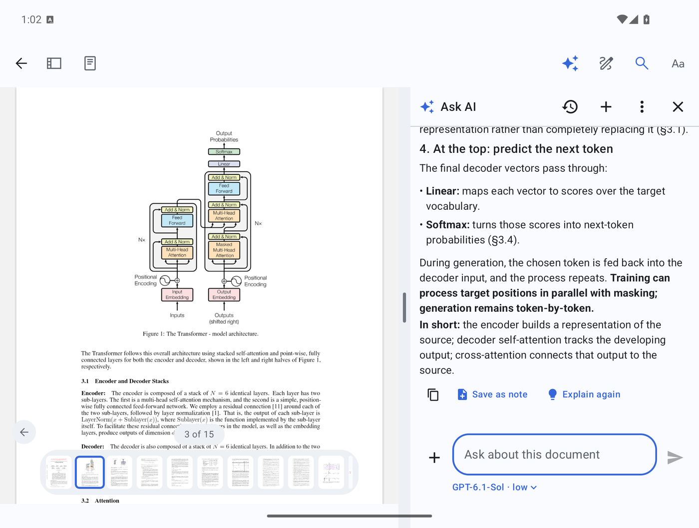
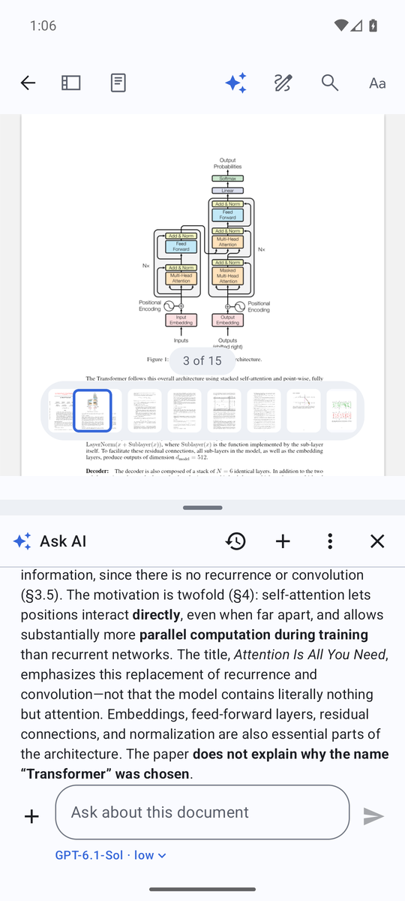
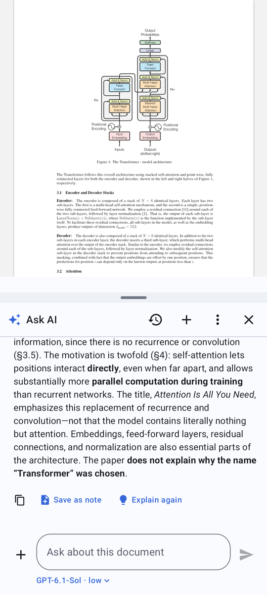
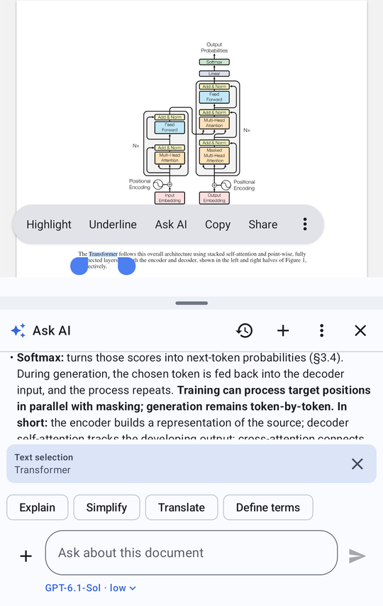
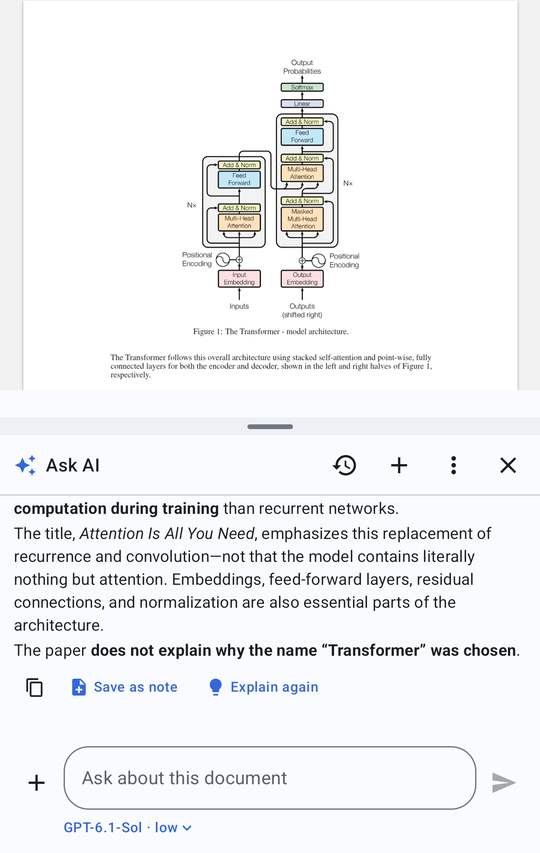
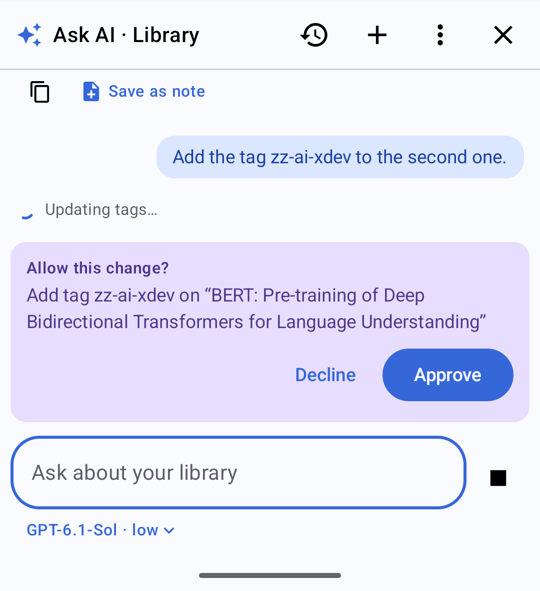
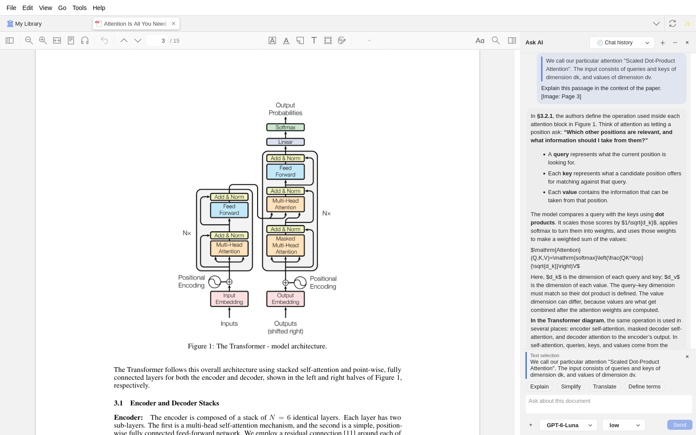
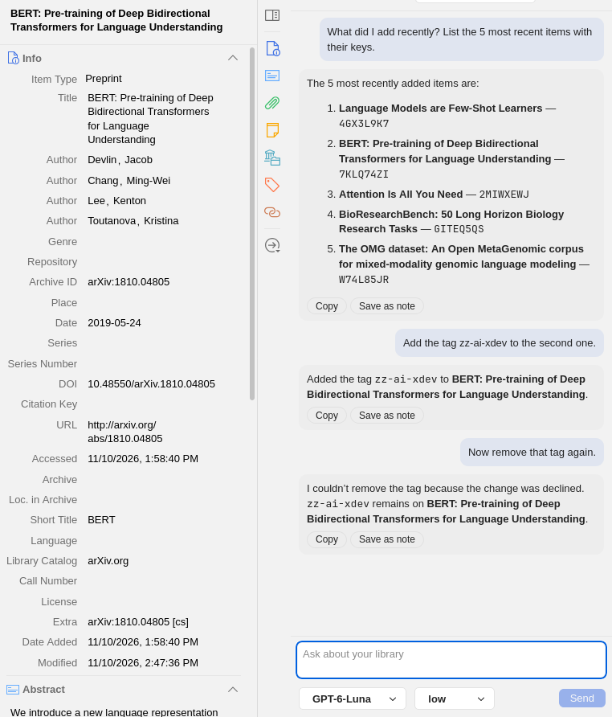

# Zotero for Android — with an AI reading assistant

This is a fork of the official [Zotero for Android](https://github.com/zotero/zotero-android) app. It adds an **AI chat panel**: in the reader, to ask about the paper you're reading (a selected passage, a figure, or the whole document) with the PDF still on screen; and on the library screen, to find, summarize and organize your papers. It signs in with your **ChatGPT account** (no API key), and every conversation is saved as a Zotero note, so it follows you to your other devices.

A matching **[Zotero desktop plugin](#zotero-desktop-plugin)** (Zotero 7–10) in [`desktop-plugin/`](desktop-plugin) gives the same panel, the same library tools and the same notes on your computer, so a conversation started on the phone can be continued on the desktop and back.

Everything else is the stock Zotero app. Work happens on the [`ai-chat-panel`](https://github.com/rajuptvs/zotero-android/tree/ai-chat-panel) branch.

<p align="center">
  
  <br><em>Unfolded foldable: the paper and the chat side by side. Here the Transformer diagram (Figure 1) was sent as an image and explained.</em>
</p>

## What it adds

**Chat next to the document**
- An ✨ **Ask AI** button in the reader toolbar opens the panel. The PDF stays visible: side by side on wide screens (unfolded foldables, tablets), PDF on top and chat below on a phone. The divider can be dragged.
- Answers stream in and are rendered as Markdown (lists, bold, code, tables, typeset math), with a status line (*Reading the document… / Thinking… / Writing the answer…*) and a Stop button.
- The model is told what you're reading: title, authors, venue, DOI, tags, abstract, the full text of the document and the page you're on.

**Select to chat**
- Text you select while the panel is open is attached as a **Text selection** chip. **Ask AI** is also in the text-selection menu, next to Highlight and Underline.
- One-tap actions for a selection: **Explain**, **Simplify**, **Translate**, **Define terms**.

**Chat with images from the PDF**
- **+ → This page (image)** sends what's on screen.
- **+ → Select an area (image)** lets you drag a box around a figure, chart, table or equation and send just that.

**Keep what's useful**
- **Save as note** under any answer saves it as its own Zotero note on the paper: your question as the heading, the passage it was about, the formatted answer, and where it came from.
- **Explain again** asks for the last answer again, intuition first.
- Copy any answer.

**Synced conversations**
- Each conversation is stored as a child note on the item (tied to that attachment), so it syncs through Zotero and shows up on your other devices — and stays readable in Zotero desktop. A history menu lists past chats for the document.

**Foldables**
- Unfolding gives the side-by-side layout; folding switches to the stacked one. The app keeps the same document, page, panel and conversation across folds. (Stock Zotero closes the open document when you fold or unfold.)

**Model choice**
- Pick any model your ChatGPT plan offers, and its reasoning effort, from the menu under the message box.

<table>
  <tr>
    <td align="center"><br><em>Phone: Ask AI under the PDF</em></td>
    <td align="center"><br><em>Phone: the chat started on the foldable, synced via Zotero</em></td>
    <td align="center"><br><em>Folded: select text → Ask AI, with quick actions</em></td>
    <td align="center"><br><em>Folded: Save as note / Explain again</em></td>
  </tr>
</table>

## Ask AI about your library

The ✨ button on the library screen opens the same panel for the whole library. The model gets
the current collection and your selected items, and can use 15 Zotero tools: search, item details,
full text, collections, tags, recent items, notes and annotations; and, **only after you approve
each change**, add or remove tags, file items into collections, create collections and notes, add
an item by DOI/ISBN/arXiv ID, or move items to the trash.

- Each change shows an **Allow this change?** card with exactly what will happen (*Add tag to-read on “BERT: …”*). Decline, and the model is told so and nothing changes. "Approve changes automatically" in the menu skips the card, except for moving items to the trash, which always asks.
- The panel shows which tools ran under each answer (*Searching your library*, *✓ Add tag …*).
- Library conversations are saved as standalone notes tagged `ai-chat`, listed under **Chat history**. If the same conversation moved on from another device, the panel picks that up before answering, so nothing is overwritten.

<p align="center">
  
  <br><em>Phone: a follow-up in a library conversation that was started on the desktop. "The second one" is resolved from the earlier desktop answer.</em>
</p>

## Zotero desktop plugin

[`desktop-plugin/`](desktop-plugin) is a Zotero 7–10 plugin with the same panel, docked to the right of the tabs:

- On the library tab it's the library assistant above, with the same tools, approval cards and wording.
- In a reader tab it's the reading assistant: **Ask AI** in the text-selection popup, select-to-chat, Explain/Simplify/Translate/Define terms, **+ → This page / Select an area** to send images, Save as note, Explain again, Chat history, model and reasoning-effort picker, Stop.
- It signs in with ChatGPT on its own (the browser redirects back to Zotero's local server at `127.0.0.1:23119`); tokens live in Zotero's login manager.

<table>
  <tr>
    <td align="center"><br><em>Desktop reader: the chat about Figure 1 started on the phone, continued here with a text selection</em></td>
    <td align="center"><br><em>Desktop library: the change approved on the phone, then a removal declined here</em></td>
  </tr>
</table>

Install: build `desktop-plugin/dist/zotero-ai.xpi` with `node desktop-plugin/scripts/build.mjs`, then in Zotero use **Tools → Plugins → ⚙ → Install Plugin From File**. See [`desktop-plugin/README.md`](desktop-plugin/README.md).

## Use your library from any agent (MCP)

The desktop plugin can also serve your library to AI agents such as **Claude Code** and **Codex**
over MCP, so they can search, read and (with your approval) organize it while Zotero is running.
You don't need the chat panel or a ChatGPT account for this.

1. In Zotero 10: **Tools → Zotero AI: Connect an agent…**, turn on **Let agents use this library**,
   and add an agent (read-only, or read and request changes).
2. Copy the command it shows, for example:
   ```bash
   claude mcp add --transport http zotero http://127.0.0.1:23119/zotero-ai/mcp --header "Authorization: Bearer zai_…"
   # or
   export ZOTERO_AI_MCP_TOKEN=zai_…
   codex mcp add zotero --url http://127.0.0.1:23119/zotero-ai/mcp --bearer-token-env-var ZOTERO_AI_MCP_TOKEN
   ```
3. Ask the agent about your library. It gets the same 15 tools as the chat panels, with the same
   results.

**Changes always come back to you.** When an agent asks to tag, file, create, add or trash
something, Zotero shows a card with exactly what will change; nothing happens until you approve.
The agent is told the change is waiting and picks up the result once you decide. The card never
steals focus and ignores clicks during its first second, so a stray keystroke can't approve
anything. You can let a trusted agent apply changes without asking (off by default); moving items
to the trash always asks. Each agent has its own token, which you can revoke at any time.

The server lives on Zotero's own local port (`127.0.0.1` only) and refuses requests from web pages.
Clients that only speak stdio can use `npx mcp-remote <url> --header "Authorization: Bearer …"`.
The protocol and guarantees are in [`ai/spec/mcp.md`](ai/spec/mcp.md).

## The same on every device

Both clients are built from one spec in [`ai/spec/`](ai/spec): the tool definitions
(`tools.json`), their exact behavior (`tools.md`: fields, sorting, errors), the prompts, the context
block sent with each request, the tool loop, and the note formats (`chat.md`).
[`ai/conformance/run.py`](ai/conformance/run.py) checks the two against each other on a real
synced library:

- every read tool returns identical JSON on Android and desktop;
- approval cards read the same for every kind of change;
- conversation notes (including ones the desktop note editor has re-saved) are read back identically, and Markdown math becomes the same note markup;
- changes made on one device are visible on the other after a sync;
- both clients apply the same approval rule to every tool;
- the MCP server lists exactly the spec's tools and returns the same results as the desktop and Android clients, and its approvals, retries, expiry, limits and token handling behave as `mcp.md` says.

All 122 checks pass. Conversations were also tested by hand across devices: library chat started on desktop, continued on the phone (change approved), then continued on desktop (change declined), and synced back; reader chat about the same paper continued back and forth.

### Compared with Zotero Agent (zotero-mcp's chat plugin)

[Zotero Agent](https://github.com/54yyyu/zotero-mcp/blob/main/docs/chat-plugin.md) is a desktop-only plugin that forwards the chat to an agent CLI on your computer (Claude Code, Codex, pi) over ACP, with library access through `zotero-cli`/zotero-mcp. This project takes a different route:

| | Zotero Agent | This project |
|---|---|---|
| Platforms | Zotero desktop | Android **and** Zotero desktop, same behavior |
| Model access | Your local agent CLI's login or API key | Sign in with ChatGPT in the app; no CLI, Node.js or Python needed |
| Library tools | `zotero-cli` (via the agent's shell) | 15 built-in tools, run inside the Zotero client, identical on both platforms |
| Writes | Agent permission cards; Zotero 10 needs `zotero-mcp authorize-local` | An approval card for every change, described in plain words |
| Use from outside agents | Through zotero-mcp | Built-in MCP server in the desktop plugin, with the same tools and approvals in Zotero |
| Conversations | Local history in the Zotero profile, resumable in the terminal | Zotero notes that sync, so a chat moves between phone and computer |
| Extras it has that this doesn't | Agent's own tools (web, shell), skills, SVG diagrams, drag-in items, context-usage ring | — |

## Sign in with ChatGPT

The panel uses OpenAI's [Sign in with ChatGPT](https://developers.openai.com/siwc/token-sharing-open-source) flow for open-source apps, so requests run on your ChatGPT Plus/Pro plan instead of an API key:

- Tap **Continue with ChatGPT**; you sign in and approve in the browser, which hands control back to the app through a local `127.0.0.1` callback (OAuth with PKCE; no client secret is involved).
- Tokens are encrypted with a key kept in the Android Keystore, refreshed automatically, revoked on sign-out, and excluded from device backups.
- Usage counts against your ChatGPT plan; the menu links to your ChatGPT usage page. "Sign in with a different account" switches accounts.
- The desktop plugin signs in separately (it's its own app connection); its tokens are kept in Zotero's login manager.

## Building

Same as upstream, see [CONTRIBUTING.md](CONTRIBUTING.md). In short:

```bash
git clone --recursive https://github.com/rajuptvs/zotero-android.git
cd zotero-android && git checkout ai-chat-panel
for s in translators translation pdf-worker citation_proc csl_locales styles; do python3 scripts/bundle_$s.py; done
for s in utilities reader document-worker; do bash scripts/bundle_$s.sh; done
./gradlew assembleDevDebug
```

No PSPDFKit key is needed: PDFs, EPUBs and snapshots all open in Zotero's web-based reader.

## Known limitations

- Images you send aren't stored in the synced note; they appear there as `[Image: …]`.
- Math is typeset with [KaTeX](https://katex.org) in the panel on both platforms and in notes saved with **Save as note** (as Zotero note math). On Android it appears once an answer has finished; while the answer is still being written, formulas show as `$…$`. Full conversation notes keep the TeX source.
- Conversation notes store one paragraph per line, so very elaborate formatting (nested lists, indented code) can come back simplified when a chat is reopened.
- The library tools work on **My Library** only, on both platforms; group libraries aren't supported yet. While you're looking at a group library, the library assistant knows that and works on My Library. A reader chat about a paper in a group library is saved as a note on that paper, so the group's members can see it.
- Sign in with ChatGPT for open-source apps is an OpenAI preview; its availability and limits may change.

## Where the code is

| Area | Files |
|---|---|
| Shared spec and cross-device tests | `ai/spec/`, `ai/conformance/` |
| ChatGPT sign-in, tokens | `app/src/main/java/org/zotero/android/ai/auth/` |
| Responses API client | `app/src/main/java/org/zotero/android/ai/api/` |
| Note format, Markdown → note HTML | `app/src/main/java/org/zotero/android/ai/chat/` |
| Library tools | `app/src/main/java/org/zotero/android/ai/tools/` |
| Chat panel UI and logic (reader and library) | `app/src/main/java/org/zotero/android/ai/ui/` |
| Split layout, foldable session restore, page/area capture | `screens/reader/ReaderAiSplitLayout.kt`, `screens/reader/ReaderSessionRestore.kt`, `screens/reader/ReaderViewModel.kt` |
| Library screen integration | `screens/allitems/` |
| Desktop plugin | `desktop-plugin/src/content/` |
| MCP server, approvals | `desktop-plugin/src/content/{mcpServer,mcpClients,approvals,approvalSheet,connectDialog}.js`, `ai/spec/mcp.md` |

---

Zotero is a project of the [Corporation for Digital Scholarship](https://digitalscholar.org/). This fork is not affiliated with or endorsed by Zotero. Licensed under the [GNU AGPL v3](COPYING), like upstream.
